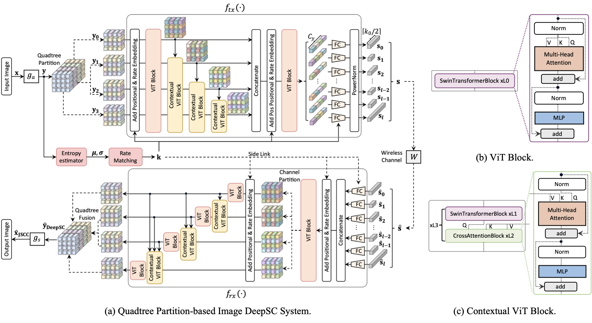
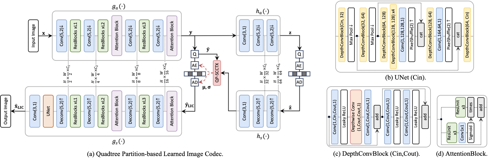

<div align="center">

# Quad-DeepSC

### Image Semantic Communication with Quadtree Partition-based Coding

**Yinhuan Huang · Zhijin Qin**  
**IEEE Journal on Selected Areas in Communications, 2026**

[Paper](https://arxiv.org/abs/2512.05395) · [IEEE](https://doi.org/10.1109/JSAC.2025.3644827) · [Usage](#usage) · [Pretrained models](#2-pretrained-models) · [Citation](#citation)

</div>

## Overview

This repository provides the inference implementation of **Quad-DeepSC and Quad-LIC from the same work**. Quad-LIC is the learned image codec used to establish the source coding components of Quad-DeepSC. Quad-DeepSC builds on these components with quadtree-guided feature coding and rate adaptation for image transmission over wireless channels.

The shared design uses four-step spatial–channel context modeling to estimate latent entropy. Lightweight image transforms support source compression, while attention-based feature coding maps the latents to channel symbols for semantic communication.

| Component | Task | Implementation | Released models |
| --- | --- | --- | --- |
| **Quad-DeepSC** | Image semantic communication over AWGN | [quad_deepsc](quad_deepsc) | 17 checkpoints: PSNR / MS-SSIM at 10 dB, LPIPS at 6 / 10 dB |
| **Quad-LIC** | Learned image compression with real rANS bitstreams | [Quad-LIC](Quad-LIC/README.md) | 9 checkpoints: 5 PSNR and 4 MS-SSIM rate points |

Both components share one environment and repository. This release includes inference and evaluation only.

### Architecture

**Quad-DeepSC: entropy-guided feature coding and wireless transmission built on Quad-LIC.**



<details>
<summary>Quad-LIC source codec architecture</summary>



Quad-LIC combines image transforms with four-step quadtree spatial–channel context modeling. Both diagrams are from the accompanying paper.

</details>

## Usage

### 1. Prerequisites and installation

Use **Linux x86-64, Python 3.12, and PyTorch 2.7.1 / CUDA 11.8**. Native builds require a C++17 compiler; CUDA builds also require a compatible toolkit and `CUDA_HOME` pointing to its installation. Dependencies are pinned in [requirements-lock.txt](requirements-lock.txt).

From the repository root, install the environment and native modules for both components:

```bash
bash scripts/setup_all.sh
source .venv/bin/activate
```

The default CUDA build target is `sm_80`. Set `TORCH_CUDA_ARCH_LIST` for another GPU. For CPU inference:

```bash
CPU_ONLY=1 bash scripts/setup_all.sh
source .venv/bin/activate
```

<details>
<summary>Build the environment and extensions separately</summary>

```bash
bash scripts/setup.sh
source .venv/bin/activate
bash scripts/setup_cuda.sh
```

`setup.sh` installs the common environment and entropy backend. `setup_cuda.sh` builds the optional native operators. To rebuild only the entropy backend in an existing environment, use `bash scripts/setup_entropy.sh`. The rANS source is bundled; no external source checkout is required. Python package installation requires network access. LPIPS downloads its VGG metric weights on first use.

</details>

### 2. Pretrained models

The two components have **26 checkpoints in total**, available in the [Google Drive release](https://drive.google.com/drive/folders/1RDJBPhQL0zmgQhczLf2T_DaORuF_NPtM). LPIPS checkpoints are supplementary inference models; the JSAC paper reports PSNR and MS-SSIM models. The commands below download complete checkpoint files into each component's checkpoint directory:

```bash
python scripts/download_checkpoints.py --model deepsc
python scripts/download_checkpoints.py --model lic
```

A single checkpoint can be selected with `--file`:

```bash
python scripts/download_checkpoints.py --model deepsc --file QJSCC_awgn_10dB_0040_psnr.pt
python scripts/download_checkpoints.py --model lic --file QSC_0006_psnr.pt
```

| Component | Download | Checkpoint directory | Model configurations |
| --- | --- | --- | --- |
| Quad-DeepSC | [Google Drive](https://drive.google.com/drive/folders/1RDJBPhQL0zmgQhczLf2T_DaORuF_NPtM) | `checkpoints/` | [17 profiles and rate/INDEX settings](checkpoints/manifest.json) |
| Quad-LIC | [Google Drive](https://drive.google.com/drive/folders/1ZiTYI1vJozInBVBJP_QS19_cVoiphswZ) | `Quad-LIC/checkpoints/` | [9 rate points](Quad-LIC/checkpoints/manifest.json) |

The downloader checks file sizes and skips existing files of the expected size. Checkpoint files may also be downloaded in a browser and copied directly into these directories. Weights are tensor-only exports and load with `weights_only=True`. Quad-DeepSC rate sets and INDEX migrations are tied to the selected profile; changing only the filename does not select a valid operating point.

### 3. Prepare Kodak

Use the 24 original Kodak RGB PNG images in a flat directory:

```text
/path/to/Kodak/
├── kodim01.png
├── kodim02.png
└── ...
```

Inputs are padded internally and reconstructions are cropped to their original size. To select one physical GPU, set `CUDA_VISIBLE_DEVICES` before running a command; the visible device is then `cuda:0` inside the process.

### 4. Test the models

**Quad-DeepSC** — evaluate an AWGN operating point:

```bash
python evaluate.py --profile psnr_awgn10_0040 \
  --dataset /path/to/Kodak --output results/deepsc_psnr_0040.json

python evaluate.py --profile lpips_awgn6_0010 \
  --dataset /path/to/Kodak --output results/deepsc_lpips_0010.json --save-recon
```

Outputs include per-image and mean PSNR, MS-SSIM, LPIPS-VGG and CBR. Rate-map PNG write/read is included in inference. Side information follows the error-free delivery assumption and its bytes are converted to nominal channel usage using the specified MCS; the evaluator does not simulate LDPC. Use `--metrics psnr --limit 1` for a short check without downloading metric weights.

**Quad-LIC** — encode and decode real rANS streams, from the same repository root:

```bash
python Quad-LIC/test_kodak.py --dataset /path/to/Kodak \
  --checkpoint Quad-LIC/checkpoints/QSC_0006_psnr.pt \
  --device cuda --output results/lic_psnr_0006.json \
  --streams results/lic_streams --reconstructions results/lic_reconstructions
```

Pass multiple files after `--checkpoint` to test several rate points. Outputs include PSNR, MS-SSIM, actual bpp, and synchronized encoding/decoding times. Actual bpp includes the rANS payload and the 12-byte image header. See the [Quad-LIC guide](Quad-LIC/README.md) for checkpoint verification and codec details.

Strict FP32 is the default for both components. Add `--allow-tf32` to enable cuDNN convolution TF32 as in the original evaluation source; matrix-multiply TF32 remains disabled. Metric networks always run with TF32 disabled. Quad-DeepSC preserves the original stochastic latent sampling and sets seed 1926 once per profile before its ordered image loop.

### 5. Measure complexity and latency

```bash
python benchmark.py --profile psnr_awgn10_0040 \
  --dataset /path/to/Kodak/kodim01.png --warmup 3 --repeats 10 \
  --cuda-kernels --sdpa --output results/deepsc_complexity_latency.json

python Quad-LIC/benchmark.py --checkpoint Quad-LIC/checkpoints/QSC_0006_psnr.pt \
  --image /path/to/Kodak/kodim01.png --device cuda --warmup 3 --iterations 10 \
  --acceleration cuda --output results/lic_complexity_latency.json
```

| Measurement | Quad-DeepSC | Quad-LIC |
| --- | --- | --- |
| Timed path | Source PNG read, padding, encode/channel/decode, rate-map PNG I/O | Encode/decode, real CPU rANS and CPU/GPU transfers |
| Excluded from latency | Quality metrics and reconstruction PNG write | PNG/stream disk I/O, padding, quality metrics and model/CDF setup |
| Arithmetic count | Supported dispatcher FLOPs/MACs | Logical Conv2d, ConvTranspose2d and Linear MACs over the roundtrip |

Latency measurement enables the CUDA backend by default and requires `bash scripts/setup_cuda.sh` first. Quad-DeepSC also enables SDPA. Reference or CPU profiling uses `--no-cuda-kernels --no-sdpa` for Quad-DeepSC or `--acceleration none` for Quad-LIC. FLOPs/MACs are counted separately on the reference model.

Both benchmarks warm up the model and synchronize CUDA before and after timed work. One MAC counts as two FLOPs. Host I/O and entropy integer operations are excluded from arithmetic counts. Each JSON records the counting and timing scope; compare measurements under the same conditions.

## Implementation notes

[docs/INFERENCE.md](docs/INFERENCE.md) documents rate selection, stochastic inference, side information, metrics and timing conventions.

## Citation

If you use Quad-DeepSC or Quad-LIC, please cite the same paper:

```bibtex
@article{huang2026quaddeepsc,
  author = {Huang, Yinhuan and Qin, Zhijin},
  title = {Image Semantic Communication with Quadtree Partition-based Coding},
  journal = {IEEE Journal on Selected Areas in Communications},
  year = {2026},
  volume = {44},
  pages = {2765--2778},
  doi = {10.1109/JSAC.2025.3644827}
}
```

## Acknowledgements and license

The implementation builds on [CompressAI](https://github.com/InterDigitalInc/CompressAI), [DCVC](https://github.com/microsoft/DCVC), [Swin Transformer](https://github.com/microsoft/Swin-Transformer), [timm](https://github.com/huggingface/pytorch-image-models) and [ryg_rans](https://github.com/rygorous/ryg_rans).

Repository code is distributed under the [MIT License](LICENSE). Third-party terms are retained in [THIRD_PARTY_NOTICES.md](THIRD_PARTY_NOTICES.md), [third_party](third_party), and the [Quad-LIC notices](Quad-LIC/third_party/NOTICE.md).
